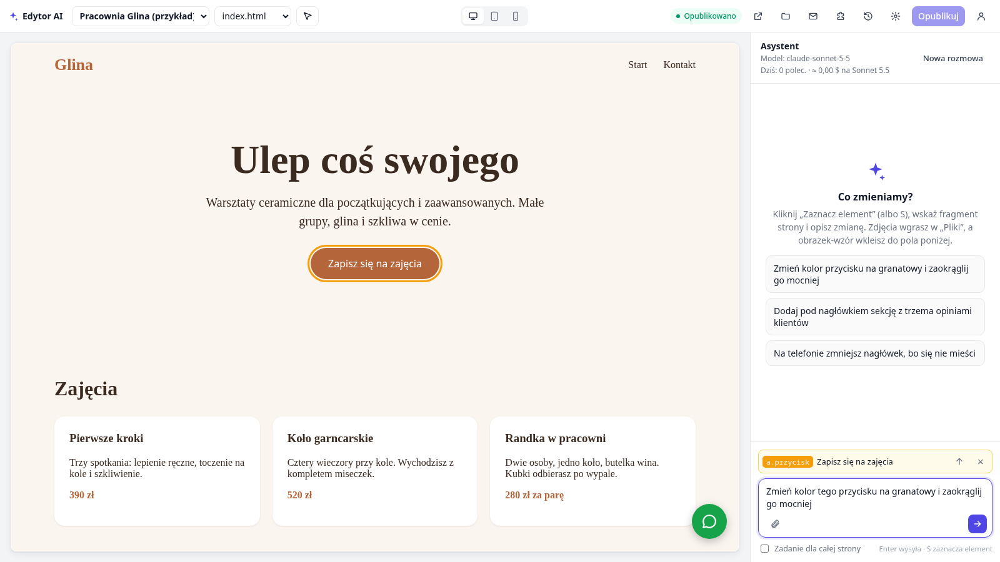

# Edytor AI

> **In English:** a self-hosted website editor driven by an AI agent. You click an element in a live preview, describe the change in plain language, and an agent built on the Claude Agent SDK edits the static files, checks the result on a headless-browser screenshot and commits it to git — every change can be previewed, reverted and published with one click. It also migrates WordPress sites to static HTML (forms from Contact Form 7, Elementor and Breakdance keep working, 301 redirects preserve SEO), runs multi-page tasks as an approved plan of small agent steps, manages custom domains with automatic HTTPS through Traefik, and has accounts with roles, a library of consent-aware integrations (analytics, cookie banner, chat) and built-in backups, alerts and monitoring. Node.js without a framework, Docker, integration tests run on every push. The documentation below is in Polish.



Narzędzie do pracy nad stronami WWW bez ręcznego pisania kodu. Zaznaczasz element w podglądzie, piszesz, co zmienić, a agent AI edytuje pliki, sprawdza efekt na zrzucie ekranu i zapisuje zmianę w historii. Publikacja to jedno kliknięcie.

| Adres (z `.env`) | Co to jest |
|---|---|
| `https://$EDYTOR_DOMENA_PANELU` | panel (konta z rolami) |
| `https://$EDYTOR_DOMENA_PODGLADU` | podgląd wersji roboczych (osobna domena, dostęp tylko przez panel) |
| `https://$EDYTOR_DOMENA_STRON/<projekt>/` | opublikowane strony projektów bez własnej domeny |
| własna domena projektu | strona projektu pod domeną klienta (ustawienia projektu + rekord A) |

## Praca z narzędziem

1. **Projekt.** Wybierz go z listy w lewym górnym rogu albo utwórz nowy: „＋ Nowy projekt…”. Do wyboru masz pustą stronę, przykład albo import gotowej strony z archiwum ZIP.
2. **Zaznacz element.** Użyj przycisku albo klawisza **S**, najedź na fragment strony i kliknij. Strzałka ↑ przy zaznaczeniu rozszerza je na element nadrzędny, np. z napisu na całą sekcję.
3. **Opisz zmianę** i naciśnij Enter. Możesz wkleić obrazek jako wzór. W czacie widać kroki agenta i zrzuty ekranu, którymi sprawdza efekt. „Zatrzymaj” przerywa pracę.
4. **Sprawdź.** Przełącznik komputer, tablet i telefon zmienia szerokość podglądu. „Pokaż przed” pokazuje stan sprzed zmiany, a „Cofnij” ją odwraca.
5. **Opublikuj.** Zmiany są w wersji roboczej, dopóki ich nie opublikujesz. W „Historii” możesz też przywrócić na stronie dowolną starszą wersję („Opublikuj tę”).

**Import istniejącej strony (np. WordPress):** „＋ Nowy projekt…” → „Import z adresu istniejącej strony”. Edytor pobiera do 300 podstron (linki i mapa strony `sitemap.xml`) z obrazkami, CSS i fontami. Przepisuje adresy na względne, usuwa śmieci WordPressa (emoji, oEmbed, generator) i przerabia formularze Contact Form 7, Breakdance i Elementora na formularze edytora. Z Breakdance przenosi stronę podziękowania (`redirectUrl`) i komunikat sukcesu, a wywołania `breakdanceForm.init` usuwa. Pod względem SEO import zachowuje:
- przekierowania 301 ze starych adresów (skróty `?p=ID` i adresy, które WordPress sam przekierowywał), zapisane w `stan.json` → `przekierowania`;
- stronę 404 oryginału jako `404.html` (serwowaną z kodem 404);
- `sitemap.xml` i `robots.txt`, generowane przy każdej publikacji, jeśli strona ich nie ma.

**Raport migracji** pokazuje się po imporcie i jest dostępny w ustawieniach projektu („Raport importu”, zapis w `dane/projekty/<id>/raport-importu.json`). Wymienia liczby (podstrony, przekierowania, formularze) i elementy, które na statycznej kopii nie działają albo wymagają sprawdzenia: wyszukiwarkę, sklep, komentarze, logowanie, formularze z załącznikami, treści ładowane przez admin-ajax/REST, skrypty śledzące (zgoda RODO), baner cookies i przełącznik języków. Przy każdym jest rada i przykładowe podstrony.

Kopie na wspólnej domenie (`/<projekt>/`) mają nagłówek `X-Robots-Tag: noindex`, żeby nie konkurowały w Google ze starą stroną. Strony z własną domeną są indeksowane normalnie. Po imporcie strona jest statyczna: wyszukiwarka, sklep, logowanie i komentarze nie działają.

**Formularze:** każdy formularz z `action="__formularz" method="post"` na opublikowanej stronie zapisuje zgłoszenia w edytorze (przycisk „Formularze”). Opcjonalnie wysyła też e-mail (adres w ustawieniach projektu i `EDYTOR_SMTP` w `.env`) i webhook (np. n8n). Ochrona przed spamem to ukryte pole `_gotcha` i limit 5 wiadomości na 10 minut z jednego adresu. Pola sterujące to `_temat` (temat powiadomienia), `_powrot` (strona podziękowania, ścieżka liczona od głównego katalogu strony, np. `dziekuje/`) i `_podziekowanie` (komunikat, gdy nie ma `_powrot`). Nazwy pól `fields[x]` z page builderów zapisują się jako `x`. Asystent wie, jak zbudować taki formularz: wystarczy polecenie „dodaj formularz kontaktowy”. W oknie „Formularze” jest eksport wszystkich zgłoszeń do CSV (średniki i BOM dla Excela, formuły unieszkodliwione), a redaktor i administrator mogą usunąć pojedyncze zgłoszenie na żądanie osoby, która je wysłała. Zgłoszenia starsze niż `EDYTOR_FORMULARZE_MIESIACE` (domyślnie 24) są usuwane automatycznie. Wzory dokumentów RODO (umowa powierzenia, klauzula przy formularzu, polityka prywatności) i opis przepływu danych są w [`docs/rodo/`](docs/rodo/README.md).

**Pliki** (zdjęcia, fonty, PDF-y) wgrywasz w oknie „Pliki”. Kliknięcie nazwy wstawia ścieżkę do polecenia, np. „wstaw obrazy/zespol.jpg pod nagłówkiem”. **Ustawienia projektu** (ikona zębatki) to nazwa, własna domena, pobranie strony jako ZIP i „Usuń projekt”. Usunięty projekt trafia do `dane/kosz/<id>-<czas>/`. Żeby go odzyskać, przenieś katalog z powrotem do `dane/projekty/<id>` i zrestartuj kontener.

**Konta i role.** Konto główne (administrator) pochodzi z `.env`: login `EDYTOR_LOGIN` (domyślnie `admin`) i hasło `EDYTOR_HASLO`. Pusty login na ekranie logowania oznacza właśnie to konto. Kolejne konta zakłada administrator: ikona osoby w prawym górnym rogu → „Konta użytkowników”. Hasło startowe generuje serwer i pokazuje je tylko raz. Użytkownik zmienia je potem sam w tym samym oknie.

| Rola | Może |
|---|---|
| administrator | wszystko: wszystkie projekty, nowe projekty i import, konta, koszty modelu, domeny, integracja „Własny kod” |
| redaktor | w przypisanych projektach: polecenia, zadania dla całej strony, publikacja, pliki, formularze (z usuwaniem), ustawienia bez domeny, integracje |
| klient | w przypisanych projektach: polecenia i cofanie zmian w wersji roboczej, podgląd, odczyt plików, wiadomości z formularzy i eksport CSV; **bez publikacji** |

Projekt spoza uprawnień wygląda jak nieistniejący (404). To dotyczy też podglądu. Zmiana roli, projektów albo hasła wylogowuje konto we wszystkich przeglądarkach. Historia zmian pokazuje, kto zlecił każdą zmianę (autor commita).

**Integracje** (przycisk z klockiem) to zamienniki popularnych wtyczek WordPressa:
- baner zgód na cookies;
- Google Analytics 4, Tag Manager, Plausible, Microsoft Clarity;
- Meta Pixel;
- czaty Smartsupp i Tawk.to;
- pływający przycisk telefonu lub WhatsApp;
- dane firmy dla Google (schema.org `LocalBusiness`);
- weryfikacja Search Console;
- własny kod (tylko administrator).

Jak działają:
- **Wstawianie przy publikacji.** Edytor wstawia je do każdej strony HTML dopiero przy publikacji, w katalogu wydania. Repozytorium strony zostaje czyste, agent ich nie widzi, a wyłączenie usuwa je w całości. Zapis integracji od razu publikuje na nowo bieżącą wersję strony.
- **Zgoda przed skryptami śledzącymi.** Skrypty GA, GTM, Clarity i Meta Pixel trafiają na stronę jako `<script type="text/plain" data-zgoda="analityka|marketing">`. Przeglądarka ich nie wykonuje, dopóki odwiedzający nie wyrazi zgody w banerze. Baner dokłada się sam, gdy włączona jest choć jedna taka integracja.
- **Baner.** Przyciski „Akceptuję wszystkie” i „Odrzucam” są równorzędne, a przycisk „Cookies” w rogu pozwala zmienić wybór. Zgoda jest zapisana w `localStorage` na 12 miesięcy, a po dodaniu nowej kategorii baner pyta ponownie.
- **Podgląd** pokazuje tylko widoczne elementy (baner, przycisk kontaktu), bez analityki. Wartości pól są sprawdzane po stronie serwera (np. `G-…`, `GTM-…`) i wstawiane z ucieczką znaków.

**Zadanie dla całej strony** (pole pod czatem): zmiany na wielu podstronach, np. „dodaj 5 podstron usług według wzoru strony O nas”. Asystent najpierw przegląda stronę w trybie tylko do odczytu i proponuje plan (do 30 kroków). Po „Wykonaj plan” każdy krok idzie osobnym, krótkim uruchomieniem agenta z osobnym commitem. Na koniec automatyczne sprawdzenie wykrywa linki i obrazki prowadzące do nieistniejących plików. „Cofnij całe zadanie” odwraca wszystkie kroki jednym commitem.

**Zużycie:** pasek u góry pokazuje liczbę dzisiejszych poleceń i szacunek kosztu, gdyby szły przez Sonnet 5.5 (w dymku: 30 dni i prognoza na miesiąc). Dane leżą w `dane/projekty/<id>/zuzycie.jsonl`. Przy darmowym modelu pole modelu ma ostrzeżenie: dostawca może zapisywać treść poleceń.

### Jak pisać polecenia

- Jedna konkretna zmiana na polecenie. Podawaj wartości („#1e3a8a”, „odstęp 40 px”) i zakres („tylko ten przycisk” albo „wszystkie przyciski”).
- Asystent pamięta rozmowę w projekcie, więc działa np. „a teraz trochę większy”. „Nowa rozmowa” czyści tę pamięć, co przydaje się przy zmianie tematu.
- Przy poleceniach twórczych opisz kierunek albo wklej obrazek z inspiracją. Samo „zrób coś fajnego” daje zachowawcze wyniki.

### Ograniczenia

- Obsługiwane są statyczne strony: HTML, CSS i JS bez etapu budowania. Astro, Next czy WordPress nie zadziałają.
- Strony bez własnej domeny działają w podkatalogu (`/<projekt>/`), więc linki muszą być względne. Agent ma to w instrukcjach.
- Jedno polecenie naraz w projekcie i najwyżej dwa naraz na całym serwerze (`EDYTOR_MAX_AGENTOW`).
- Darmowe modele OpenRoutera mają limit zapytań na minutę i na dzień (konto doładowane ≥ 10 $: 1000 dziennie). Po przekroczeniu czat po kilku sekundach pokazuje komunikat (agent ponawia najwyżej 2 razy, `CLAUDE_CODE_MAX_RETRIES`). Sprawdzone na prawdziwym 429 z OpenRoutera 30.10.2026.
- `thinkingmachines/inkling:free` OpenRouter udostępnia tylko „harnessom agentowym” (np. Claude Code). Bezpośrednie zapytania do API z tym kluczem dostają 403, więc do testów używaj agenta.

## Architektura

- `serwer.mjs` uruchamia trzy serwery HTTP w jednym procesie:
  - **panel** (8080): interfejs i API `/api/projekty`, `/api/p/<projekt>/<akcja>`;
  - **podgląd** (8082): wersje robocze z wstrzykniętym `wybieracz.js`;
  - **strony** (8081): opublikowane wersje, po nagłówku `Host` (własna domena projektu) albo pod `/<projekt>/`.
- `projekty.mjs` obsługuje projekt w `dane/projekty/<id>/`:
  - `strona/` to wersja robocza i repozytorium git;
  - `wydania/` zawiera opublikowane wersje, a `produkcja` to dowiązanie do aktualnego wydania;
  - `stan.json` przechowuje nazwę, domenę, sesję agenta i ostatnią publikację.
  
  Moduł realizuje też import ZIP (`bsdtar`, który odrzuca `..` i ścieżki bezwzględne; dowiązania i `.git` są usuwane), wgrywanie plików (biała lista rozszerzeń i znaków w nazwach) oraz eksport (`git archive --format=zip`).
- `agent.mjs` uruchamia Claude Agent SDK z narzędziami `Read`, `Edit`, `Write`, `Glob`, `Grep` i `zrzut_strony` (bez Bash). Hook `PreToolUse` sprawdza każde wywołanie: ścieżki po `realpath` muszą leżeć w katalogu strony i omijać `.git`, a wzorce nie mogą zawierać `..`. Błędy API są tłumaczone na zrozumiałe komunikaty. Model zapasowy (`EDYTOR_MODEL_ZAPASOWY`) przejmuje pracę, gdy główny jest przeciążony.
- `siec.mjs`: pobieranie z internetu z ochroną przed SSRF. Sprawdza IP po rozwiązaniu DNS przy każdym połączeniu (undici `connect.lookup`), sprawdza adresy podane wprost jako IP, prowadzi przekierowania ręcznie i ogranicza rozmiar odpowiedzi.
- `importer.mjs`: crawler (cheerio) importu z adresu. Faza 1 pobiera, faza 2 przepisuje adresy i robi porządki.
- `zadania.mjs`: zadania globalne — instrukcje planu, odczyt planu (JSON) z odpowiedzi modelu, polecenie dla kroku i deterministyczne sprawdzenie linków po zadaniu. API: `/api/p/<id>/plan`, `/zadanie`, `/cofnij-zadanie`.
- `formularze.mjs`: przyjmowanie formularzy na stronach publicznych. Najpierw zapis do `dane/projekty/<id>/formularze/RRRR-MM.jsonl` (poza stroną, niepublikowany), potem powiadomienia (nodemailer, webhook).
- `konta.mjs`: konta i role. Hasła jako skrót scrypt z solą, porównanie w stałym czasie (także dla nieistniejącego loginu), mapa akcji dozwolonych dla ról.
- `integracje.mjs`: katalog integracji z walidacją pól, fragmenty HTML, skrypt banera zgód i wstawianie do wydania.
- `zrzuty.mjs`: headless Chromium (Playwright) renderuje stronę z dysku w szerokości 1280 px albo 390 px. Agent dostaje obraz w wyniku narzędzia i sam ocenia efekt (najwyżej 4 zrzuty na polecenie).
- **Bezpieczeństwo:**
  - podgląd ma inny origin niż panel, więc JS strony nie sięga do panelu, a z panelem rozmawia tylko przez `postMessage` z kontrolą nadawcy;
  - każda strona podglądu działa w piaskownicy (`Content-Security-Policy: sandbox` bez `allow-same-origin`), czyli w pustym originie. Skrypt w wersji roboczej jednego projektu nie odczyta przez to wersji roboczych innych projektów, choć wszystkie leżą na tej samej domenie. Skutek uboczny: skrypty strony nie mają w podglądzie dostępu do `localStorage` ani `document.cookie`. Opublikowana strona działa normalnie;
  - panel ma CSP z `script-src 'self'` i `frame-ancestors 'none'`;
  - zapisy POST są przyjmowane tylko z `Sec-Fetch-Site: same-origin`;
  - ciasteczka (`rodzaj.login.wygasa.wersja.podpis`) są podpisane HMAC kluczem zależnym od hasła z `.env`. Wersja to licznik konta, więc wylogowanie, zmiana hasła albo uprawnień unieważnia wszystkie sesje tego konta;
  - każde zapytanie API sprawdza dostęp konta do projektu i akcji, a interfejs tylko ukrywa niedostępne przyciski;
  - obowiązuje limit 10 prób logowania na 15 minut na adres (ostatni wpis w `X-Forwarded-For`).
- **Spójność:** blokada per projekt zajmowana przed pierwszym `await`, licznik aktywnych agentów, atomowy zapis stanu (plik tymczasowy + `rename`) i atomowa publikacja (podmiana dowiązania).

## Konfiguracja (`.env`, uprawnienia 600)

Opis zmiennych jest w `.env.example`. Hasło do panelu jest też lokalnie w `~/.config/edytor-ai/dostep.env`.

## Wdrożenie (VPS)

```bash
# pierwszy raz na serwerze: mkdir -p /opt/edytor-ai/dane /opt/edytor-ai/kopie && chown 1000:1000 /opt/edytor-ai/dane /opt/edytor-ai/kopie
# lokalnie: cp narzedzia/wdroz.env.example narzedzia/wdroz.env (adres serwera, klucz SSH, adresy panelu i stron)
narzedzia/wdroz.sh
```

`narzedzia/wdroz.sh` wdraża wyłącznie zacommitowany stan (`git archive HEAD`). Przy niezacommitowanych zmianach odmawia. Kolejne kroki:
1. uruchamia testy i **przerywa wdrożenie, jeśli któryś nie przejdzie**;
2. robi kopię danych na serwerze;
3. zapisuje odcisk (md5) każdej opublikowanej strony;
4. wysyła kod i przebudowuje kontener;
5. czeka na `/zdrowie`;
6. sprawdza, czy opublikowane strony się nie zmieniły;
7. zapisuje na serwerze plik `/opt/edytor-ai/WERSJA` (commit i data), dodaje tag `wdrozenie-RRRRMMDD-GGMM` i wypycha `main` z tagiem do `origin`.

Powrót do poprzedniej wersji: `git checkout wdrozenie-<poprzedni>`, potem `narzedzia/wdroz.sh`, a na koniec `git checkout main`.

Strony publiczne mają ETag (odpowiedź 304, gdy plik się nie zmienił) i cache zależny od typu: HTML 60 s, CSS/JS/obrazy 5 min, fonty tydzień. Traefik kompresuje odpowiedzi tekstowe (middleware `edytor-kompresja`), z pominięciem strumienia czatu.

**Alerty:** co 10 minut serwer sprawdza wolne miejsce na dysku (próg `EDYTOR_ALERT_MIEJSCE_PROCENT`, domyślnie 10%) i świeżość kopii zapasowej (alert przy błędzie albo kopii starszej niż 26 h). Liczy też błędy asystenta i alarmuje po trzech nieudanych poleceniach z rzędu. Alert idzie jako POST na `EDYTOR_ALERT_WEBHOOK`. Dla ntfy.sh to zwykły tekst (powiadomienie w aplikacji), a dla każdego innego adresu JSON `{rodzaj, tekst, tresc, serwer, kiedy}`, np. dla webhooka n8n (`https://<twoj-n8n>/webhook/<losowa-ścieżka>`; ścieżka działa jak hasło). Ten sam problem wraca najwyżej co 6 godzin. Bez adresu alerty trafiają tylko do logów. Wolne miejsce pokazuje też `/zdrowie` (`wolneMiejsceProcent`). Awarii całego serwera ten mechanizm nie zgłosi, bo alert wysyła sam serwer. Od tego jest monitor zewnętrzny.

**Monitor zewnętrzny (Healthchecks.io)** działa jak „dead man's switch”. Co 5 minut serwer melduje się pod `EDYTOR_MONITOR_URL` (adres pingu, np. `https://hc-ping.com/<uuid>`). Przed meldunkiem sprawdza dysk, kopię i to, czy panel odpowiada pod publicznym adresem (Traefik, certyfikat, DNS). Gdy wszystko jest w porządku, wysyła POST z krótkim stanem. Gdy wykryje problem, wysyła POST na `…/fail` z opisem. Gdy meldunki ustaną, bo padł VPS, Docker albo proces, Healthchecks.io po okresie karencji sam wysyła powiadomienie. Zadziała to także wtedy, gdy nie działa nic na serwerze, łącznie z n8n.

Restart przy wdrożeniu przerywa pracujących asystentów. Czat pokazuje wtedy komunikat o aktualizacji serwera (nie „Zatrzymano”) i polecenie trzeba powtórzyć. `wdroz.sh` tylko o tym informuje i nie czeka.

Kontener ma healthcheck (`/zdrowie`). Traefik kieruje do niego ruch dopiero przy stanie `healthy`, czyli około 30 s po starcie.

**Własna domena projektu** (automatycznie):
1. W ustawieniach projektu wpisz domenę, np. `www.klient.pl`.
2. U rejestratora ustaw rekord A (i opcjonalnie AAAA) tej domeny na adres serwera z `EDYTOR_IP_SERWERA` i usuń stare rekordy A/AAAA wskazujące na poprzedni hosting.
3. Edytor co 5 minut (i od razu po zapisie) sprawdza DNS. Gdy wszystkie rekordy wskazują na serwer (`EDYTOR_IP_SERWERA`), dopisuje router do `/opt/traefik-dynamiczne/edytor-domeny.yml`. Traefik czyta ten katalog przez `--providers.file.directory` z `watch`, więc dodaje trasę w locie i sam pobiera certyfikat Let's Encrypt (HTTP-01). Ustawienia projektu pokazują stan: „wskazuje na serwer”, „brak rekordu A” albo „wskazuje na inny serwer”.

Router dopisywany jest dopiero po poprawnym DNS, bo każda nieudana walidacja Let's Encrypt zużywa limit (5 na godzinę na domenę). Routery z pliku wskazują usługę `edytor-strony@docker` i kompresję `edytor-kompresja@docker` z etykiet kontenera. Traefik pozwala na takie odwołania między providerami. Traefik musi mieć provider plikowy: `--providers.file.directory=/dynamiczne`, `--providers.file.watch=true` i wolumen `/opt/traefik-dynamiczne:/dynamiczne:ro`.

**Kopie zapasowe** są wbudowane. Przy starcie i potem raz na dobę serwer pakuje `dane/` (bez `dane/claude`, czyli pamięci rozmów agenta) do `kopie/` na hoście i trzyma 14 ostatnich kopii. Datę ostatniej kopii pokazuje `/zdrowie` (`ostatniaKopia`). Kopię na żądanie robi `narzedzia/kopia.sh` (dodatkowo pakuje `.env`).

**Kopia poza serwerem (Hetzner Storage Box).** Kopie w `kopie/` leżą na tym samym dysku co dane, więc nie chronią przed awarią VPS-a ani włamaniem. Dlatego `narzedzia/kopia-zdalna.sh` z timerem systemd `edytor-kopia.timer` (codziennie o 3:40) wysyła `dane/` i `.env` przez restic na Storage Box. **Stan: przygotowane, niewłączone.** restic i klucz są na VPS-ie, brakuje Storage Boksa. Po jego założeniu: `systemctl enable --now edytor-kopia.timer`.
- dane są szyfrowane na VPS-ie, zanim opuszczą serwer, a Storage Box widzi tylko zaszyfrowane bloki;
- deduplikacja sprawia, że codziennie idą tylko zmiany;
- rotacja: 14 kopii dziennych, 8 tygodniowych i 12 miesięcznych;
- `restic check` sprawdza repozytorium po każdej kopii, a w niedziele dodatkowo czyta 10% danych.

Konfiguracja na VPS-ie:
- `/root/.ssh/storagebox_ed25519` to osobny klucz tylko do kopii;
- w `/root/.ssh/config` jest host `storagebox` (port 23);
- `/root/.config/edytor-kopia/env` ustawia `RESTIC_REPOSITORY=sftp:storagebox:edytor-ai` i `RESTIC_PASSWORD_FILE=/root/.config/edytor-kopia/haslo`.

**Bez hasła restic kopii nie da się odczytać.** Musi być także poza VPS-em, np. w menedżerze haseł. Data ostatniej udanej kopii: `/var/lib/edytor-kopia/ostatnia-udana`.

Przywrócenie z Storage Boksa (na tym albo nowym serwerze z restic i tą samą konfiguracją):
```bash
restic snapshots                                  # lista kopii
restic restore latest --target /tmp/odtworzenie   # pliki trafiają do /tmp/odtworzenie/opt/edytor-ai/...
```
Potem `docker compose stop`, podmiana `dane/` i `.env`, `chown -R 1000:1000 dane` i `docker compose up -d`.

Przywrócenie z kopii lokalnej: `docker compose stop`, potem `tar xzf kopie/<plik>.tgz -C dane` (przy pustym `dane`), `chown -R 1000:1000 dane` i `docker compose up -d`.

## Testy na GitHubie (CI)

`.github/workflows/testy.yml` uruchamia `npm test` przy każdym pushu na `main` i przy pull requestach: Node 24 jak w obrazie Dockera i `bsdtar` do importu ZIP. Wynik widać w zakładce **Actions** repozytorium i przy commitach (zielony ✓ albo czerwony ✗). `narzedzia/wdroz.sh` i tak uruchamia testy lokalnie przed wdrożeniem. CI pilnuje tego samego dla kodu, który trafia do repozytorium inną drogą.

## Publiczne repozytorium (portfolio)

`narzedzia/portfolio.sh ["opis zmian"]` (z `--sprawdz`: same kontrole, bez wysyłki) wysyła do publicznego repozytorium (`PORTFOLIO_REPO` w `narzedzia/wdroz.env`) migawkę bieżącego commita jako jeden nowy commit, bez historii prywatnego repozytorium. Wcześniej sprawdza migawkę na trzy sposoby i przy każdym trafieniu niczego nie wypycha:
1. wzorce kluczy API i kluczy prywatnych;
2. frazy z nieśledzonego `narzedzia/portfolio-zakazane.txt` (nazwy klientów, IP i domeny serwera);
3. prawdziwe wartości sekretów z `.env` na serwerze, pobierane przez SSH i nigdy niewypisywane.

## Lokalnie

```bash
npm install
npm test
EDYTOR_DANE=/tmp/dane EDYTOR_HASLO=test EDYTOR_SEKRET=x \
EDYTOR_PORT_PANELU=18080 EDYTOR_PORT_STRONY=18081 EDYTOR_PORT_PODGLADU=18082 \
EDYTOR_ADRES_PANELU=http://localhost:18080 EDYTOR_ADRES_PODGLADU=http://localhost:18082 \
EDYTOR_ADRES_STRON=http://localhost:18081 node serwer.mjs
```

Panel i podgląd muszą być w tej samej witrynie w sensie przeglądarki (np. oba `localhost` albo oba `*.example.com`). Inaczej przeglądarki blokujące ciasteczka stron trzecich nie wyślą ciasteczka podglądu (`SameSite=None`, bo strony podglądu działają w piaskownicy). Do zrzutów potrzebny jest Chromium (`EDYTOR_CHROMIUM`, domyślnie `/usr/bin/chromium`). Bez niego agent działa, tylko nie widzi efektu.
